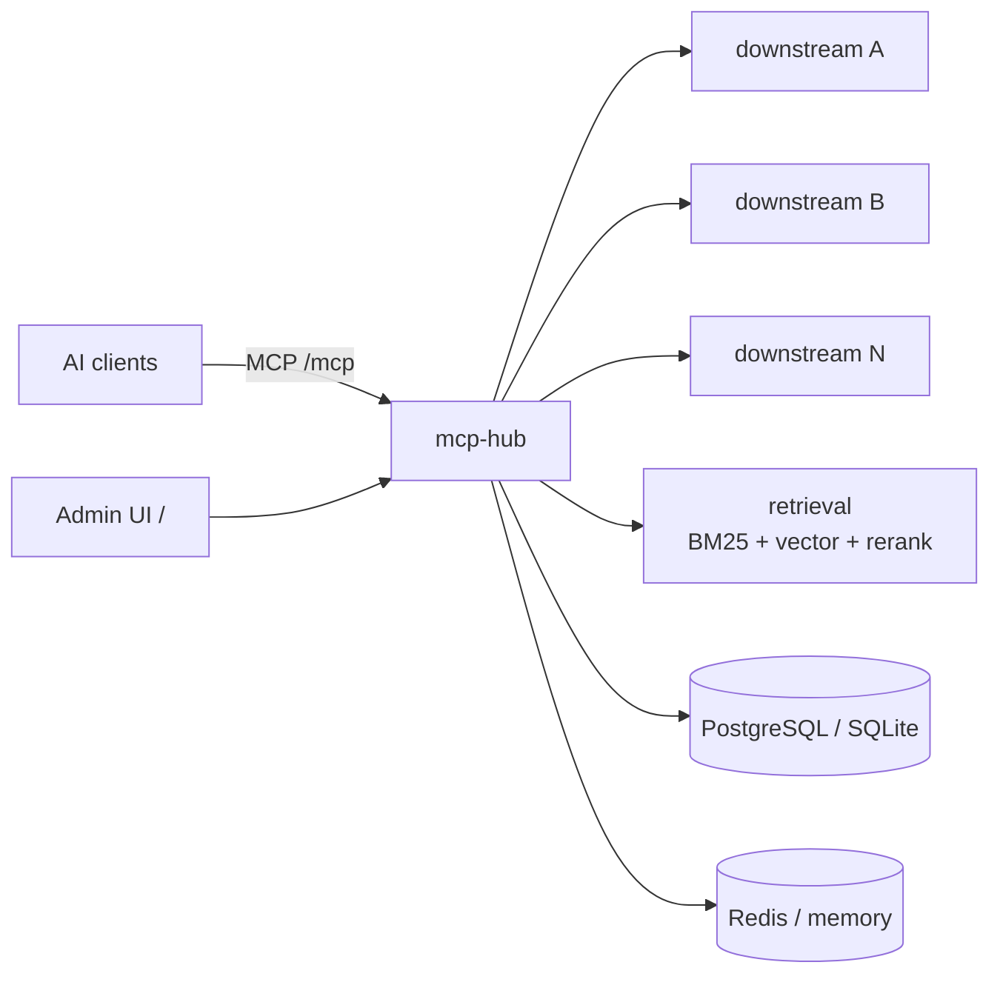

# mcp-hub

> 把多个下游 MCP server 聚合成一个 MCP 端点，按意图检索工具，而不是把所有 schema 塞进上下文。
>
> One MCP endpoint for all your downstream MCP servers — intent-based tool discovery instead of dumping every schema into the context window.

[English](#english) · [简体中文](#简体中文)

---

## English

### Overview

`mcp-hub` is a self-hosted MCP (Model Context Protocol) aggregation gateway. It connects to multiple downstream MCP servers over **stdio**, **SSE**, or **streamable HTTP**, merges their tools into a single `/mcp` endpoint, and lets AI clients discover tools by intent. In the default `meta` list mode only five `hub__*` tools are exposed; clients search for what they need, then fetch the chosen tool's schema. This keeps large tool catalogs out of the model context while making every downstream tool reachable.

### Features

- **Single MCP endpoint** — every downstream tool is exposed as `<serverKey>__<toolName>` behind one `/mcp` endpoint.
- **Intent-based retrieval** — BM25 + embedding recall fused with RRF, optional reranking.
- **Meta-tool mode** — `hub__search_tools`, `hub__list_categories`, `hub__list_servers`, `hub__list_tools`, `hub__tool`.
- **Credential pool & health probing** — multiple credentials per downstream with cooling, retirement and recovery; periodic probes, failure backoff, and automatic unblock after a successful call.
- **Admin UI** — React 19 + Vite + Tailwind v4, embedded into the Go binary via `go:embed`.
- **Flexible storage & deployment** — PostgreSQL (with pgvector) or pure-Go SQLite; Redis or in-process cache; CLI server, Docker, and Wails v3 desktop app.
- **Access control** — `MCPHUB_API_KEY` protects the admin API; access keys created in the UI protect the `/mcp` endpoint.

### Quick start

Prerequisites: Go **1.25.11+**, Node.js **22+**, Docker + Compose, GNU Make.

```bash
git clone <REPO_URL>
cd <REPO_DIR>
cp mcp-hub/.env.example mcp-hub/.env   # edit DB / cache / embedding settings
make dev
```

Admin UI: http://127.0.0.1:5273 · MCP endpoint: http://127.0.0.1:9090/mcp · Admin API: http://127.0.0.1:9090/api/overview

Zero-config (SQLite + in-memory cache, no embedded UI): `cd mcp-hub && go run ./cmd/mcp-hub serve`.

Docker (gateway + PostgreSQL + Redis, UI embedded): `make docker-up` → http://127.0.0.1:9090.

The Dockerfile defaults to China-region mirrors for base images, npm, and Go modules; override when needed, e.g. `BASE_REGISTRY=docker.io make docker-build`.

### Architecture



### Documentation

- [Deployment guide](docs/deployment.md)
- [CLI reference](docs/cli.md)
- [Desktop app](docs/desktop.md)
- [Hub architecture](docs/hub.md)
- [Downstream connections](docs/downstream.md)
- [Store layer](docs/store.md)
- [Search layer](docs/search.md)

Configuration: `mcp-hub env` prints every variable and default; see [`.env.example`](mcp-hub/.env.example) and the CLI reference. Build and test commands: [command reference](docs/deployment.md#8-命令速查).

### Security

- The service binds to `127.0.0.1` by default. Set `MCPHUB_API_KEY` and create a `/mcp` access key before exposing it.
- Downstream credentials are stored in the configured database. Treat database files and backups as secrets.
- Put a TLS-terminating reverse proxy in front when exposing the service outside localhost.

See the [deployment guide](docs/deployment.md) for ports, auth scopes, and container specifics.

### License

Apache License 2.0. See [LICENSE](LICENSE).

Bundled icon assets are generated from [Lucide](https://lucide.dev) (ISC); their license notices are preserved in the SVG files.

---

## 简体中文

### 这是什么

`mcp-hub` 是一个自托管的 MCP 聚合网关：通过 **stdio**、**SSE** 或 **streamable HTTP** 连接多个下游 MCP server，把工具聚合成**一个** `/mcp` 端点，让 AI 客户端按意图检索工具。默认的 `meta` 列表模式只暴露 5 个 `hub__*` 工具，客户端先搜索、再按需取参数定义，工具很多的场景下能显著降低上下文占用。

### 特性

- **单一 MCP 端点**：所有下游工具以 `<serverKey>__<toolName>` 暴露在 `/mcp` 后面。
- **意图检索**：BM25 + 向量召回经 RRF 融合，可选 rerank 精排。
- **凭据池与健康探活**：每个下游可配多把凭据（冷却、退休、恢复入池）；周期探活、失败退避、连续失败后暂停调用、成功后自动解除。
- **多种形态**：命令行服务、Docker、Wails v3 桌面端；存储可选 PostgreSQL（pgvector）或纯 Go SQLite，缓存可选 Redis 或进程内缓存。
- **访问控制**：`MCPHUB_API_KEY` 保护管理接口，界面里创建的接入 key 保护 `/mcp`。

### 快速开始

前置要求：Go **1.25.11+**、Node.js **22+**、Docker + Compose、GNU Make。命令与上方 Quick start 相同（`git clone` → `cp mcp-hub/.env.example mcp-hub/.env` → `make dev`）。

| 入口 | 地址 |
|---|---|
| 管理后台 | http://127.0.0.1:5273 |
| MCP 端点 | http://127.0.0.1:9090/mcp |
| 管理接口 | http://127.0.0.1:9090/api/overview |

零配置试跑：`cd mcp-hub && go run ./cmd/mcp-hub serve`（SQLite + 内存缓存，不带管理界面）。整套容器：`make docker-up`，管理界面与 MCP 端点都在 http://127.0.0.1:9090。

### 文档

[部署说明](docs/deployment.md) · [CLI 入口](docs/cli.md) · [桌面端](docs/desktop.md) · [聚合核心](docs/hub.md) · [下游连接](docs/downstream.md) · [存储层](docs/store.md) · [检索基座](docs/search.md)

配置项见 [`mcp-hub/.env.example`](mcp-hub/.env.example)，`mcp-hub env` 会打印全部变量及默认值；构建与测试命令见[部署文档的命令速查](docs/deployment.md#8-命令速查)。

### 安全

默认只监听 `127.0.0.1`；对外提供服务前必须设置 `MCPHUB_API_KEY`，并在界面里创建 `/mcp` 接入 key。下游凭据存在配置的数据库里，请把数据库文件与备份当作密钥对待；暴露到 localhost 之外时建议前置终止 TLS 的反向代理。细节见[部署说明](docs/deployment.md)。

### License

Apache License 2.0，见 [LICENSE](LICENSE)。内置图标资源来自 [Lucide](https://lucide.dev)（ISC 许可），许可证声明保留在各 SVG 文件中。
