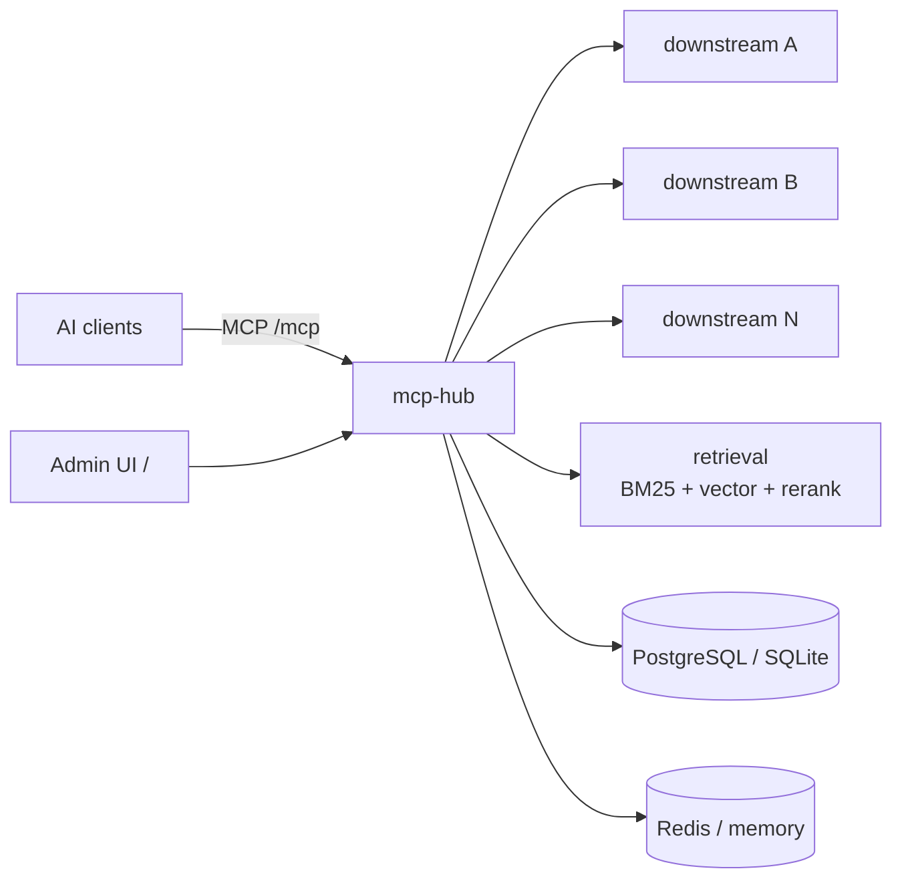
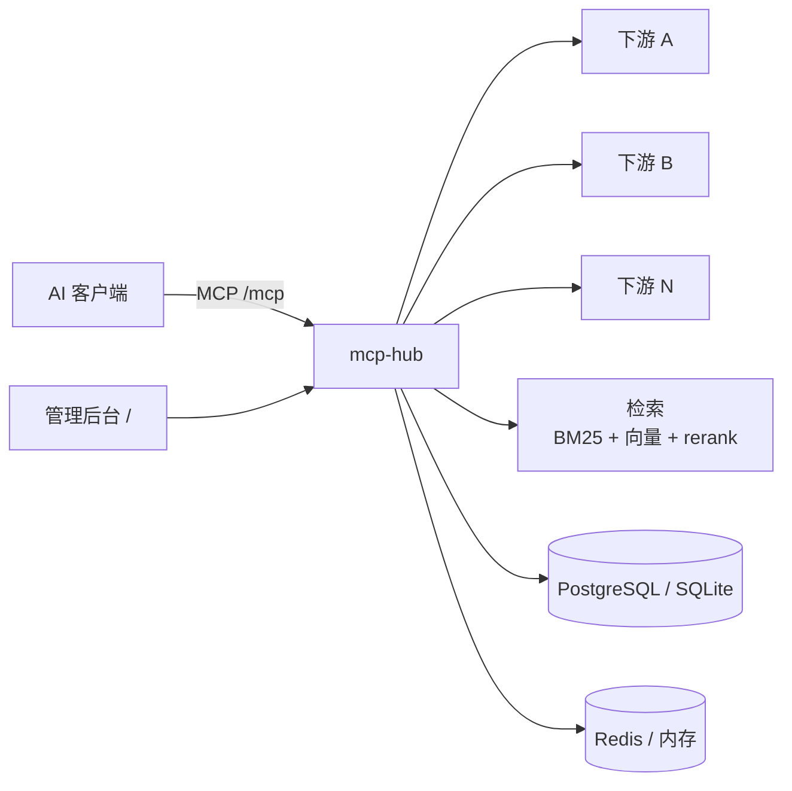

# mcp-hub

> 把多个下游 MCP server 聚合成一个 MCP 端点，按意图检索工具，而不是把所有 schema 塞进上下文。
>
> One MCP endpoint for all your downstream MCP servers — intent-based tool discovery instead of dumping every schema into the context window.

[English](#english) · [简体中文](#简体中文)

---

## English

### What is mcp-hub?

`mcp-hub` is a self-hosted MCP (Model Context Protocol) aggregation gateway. It connects to multiple downstream MCP servers over **stdio**, **SSE**, or **streamable HTTP**, merges their tools into a single MCP endpoint, and lets AI clients discover tools by intent.

The default `meta` list mode exposes only five `hub__*` tools. Clients search for what they need, then fetch the schema of the chosen tool. This keeps large tool catalogs out of the model context while still making every downstream tool reachable.

### Features

- **Single MCP endpoint** — every downstream tool is exposed as `<serverKey>__<toolName>` behind one `/mcp` endpoint.
- **Intent-based retrieval** — BM25 + embedding recall fused with RRF, optional reranking. Embedding uses an OpenAI-compatible endpoint; the reranker talks to a `/rerank` endpoint and can be disabled.
- **Meta-tool mode** — `hub__search_tools`, `hub__list_categories`, `hub__list_servers`, `hub__list_tools`, `hub__tool`.
- **Credential pool** — multiple credentials per downstream, automatic cooling on rate limits, retirement of invalid keys, and recovery back into the pool.
- **Health probing** — periodic probes, failure backoff, configurable suspension after repeated failures, automatic unblock after a successful call.
- **Admin UI** — React 19 + Vite + Tailwind v4, embedded into the Go binary via `go:embed`.
- **Storage choices** — PostgreSQL (with pgvector) or pure-Go SQLite; Redis or in-process cache.
- **Three deployment forms** — CLI server, Docker, and a Wails v3 desktop app.
- **Access control** — `MCPHUB_API_KEY` protects the admin API; access keys created in the UI protect the `/mcp` endpoint.

### Quick start

Prerequisites: Go **1.25.11+**, Node.js **22+**, Docker + Compose, GNU Make.

```bash
git clone <REPO_URL>
cd <REPO_DIR>
cp mcp-hub/.env.example mcp-hub/.env   # edit DB / cache / embedding settings
make dev
```

- Admin UI: http://127.0.0.1:5273
- MCP endpoint: http://127.0.0.1:9090/mcp
- Admin API: http://127.0.0.1:9090/api/overview

Zero-config (SQLite + in-memory cache, no UI embedded):

```bash
cd mcp-hub
go run ./cmd/mcp-hub serve
```

Docker (gateway + PostgreSQL + Redis, UI embedded):

```bash
make docker-up
# UI and MCP endpoint: http://127.0.0.1:9090
```

The Dockerfile defaults to China-region mirrors for base images, npm, and Go modules. Override them when needed:

```bash
BASE_REGISTRY=docker.io make docker-build
```

### Architecture



### Configuration

All configuration comes from environment variables or `mcp-hub/.env`. `mcp-hub env` prints the full list.

| Variable | Default | Purpose |
|---|---|---|
| `MCPHUB_ADDR` | `127.0.0.1:9090` | Listen address |
| `MCPHUB_DB` | empty → SQLite | `postgres://…` or a SQLite file path |
| `MCPHUB_CACHE` | empty → in-memory | `redis://…` for multi-instance deployments |
| `MCPHUB_API_KEY` | empty | Protects `/api/*`; set it before exposing the service |
| `MCPHUB_LIST_MODE` | `meta` | `meta` (5 discovery tools) or `all` |
| `MCPHUB_EMBED_BASE_URL` | SiliconFlow | OpenAI-compatible embedding endpoint |
| `MCPHUB_RERANK_MODEL` | `BAAI/bge-reranker-v2-m3` | Empty disables reranking |

### Documentation

- [Deployment guide](mcp-hub/docs/deployment.md)
- [CLI reference](mcp-hub/cmd/mcp-hub/README.md)
- [Desktop app](mcp-hub/cmd/mcp-hub-desktop/README.md)
- [Hub architecture](mcp-hub/internal/hub/README.md)
- [Downstream connections](mcp-hub/internal/downstream/README.md)
- [Store layer](mcp-hub/internal/store/README.md)

### Development

```bash
make check       # gofmt check + go vet + tests
make ui          # build the admin UI into the Go embed directory
make build       # build mcp-hub/bin/mcp-hub
make build-desktop
```

### Security

- The service binds to `127.0.0.1` by default. Do not expose it to a network without `MCPHUB_API_KEY` and `/mcp` access keys.
- Downstream credentials are stored in the configured database. Treat database files and backups as secrets.
- Put a TLS-terminating reverse proxy in front when exposing the service outside localhost.

### License

Apache License 2.0. See [LICENSE](LICENSE).

Bundled icon assets are generated from [Lucide](https://lucide.dev) (ISC); their license notices are preserved in the SVG files.

---

## 简体中文

### 这是什么

`mcp-hub` 是一个自托管的 MCP 聚合网关。它通过 **stdio**、**SSE** 或 **streamable HTTP** 连接多个下游 MCP server，把它们的工具聚合成**一个** MCP 端点，让 AI 客户端按意图检索工具，而不是把成百上千个工具 schema 全塞进上下文。

默认的 `meta` 列表模式只暴露 5 个 `hub__*` 工具：客户端先搜索需要的能力，再按需取参数定义。工具很多的场景下，这能显著降低上下文占用，同时不丢失任何下游能力。

### 特性

- **单一 MCP 端点**：所有下游工具以 `<serverKey>__<toolName>` 暴露在 `/mcp` 后面。
- **意图检索**：BM25 + 向量召回经 RRF 融合，可选 rerank 精排；embedding 走 OpenAI 兼容接口，rerank 走 `/rerank` 接口，可单独关闭。
- **Meta 工具**：`hub__search_tools`、`hub__list_categories`、`hub__list_servers`、`hub__list_tools`、`hub__tool`。
- **凭据池**：每个下游可配多把凭据，支持限流冷却、失效凭据自动退休、恢复后重新入池。
- **健康探活**：周期探活、失败退避、连续失败后暂停调用、调用成功后自动解除拦截。
- **管理后台**：React 19 + Vite + Tailwind v4，通过 `go:embed` 编进二进制，部署时不需要单独起前端。
- **存储可选**：PostgreSQL（配合 pgvector 走原生向量路径）或纯 Go SQLite；缓存可选 Redis 或进程内缓存。
- **三种形态**：命令行服务、Docker、Wails v3 桌面端。
- **访问控制**：`MCPHUB_API_KEY` 保护管理接口，界面里创建的接入 key 保护 `/mcp`。

### 快速开始

前置要求：Go **1.25.11+**、Node.js **22+**、Docker + Compose、GNU Make。

```bash
git clone <仓库地址>
cd <仓库目录>
cp mcp-hub/.env.example mcp-hub/.env   # 按需改 DB / 缓存 / embedding
make dev
```

启动后：

| 入口 | 地址 |
|---|---|
| 管理后台 | http://127.0.0.1:5273 |
| MCP 端点 | http://127.0.0.1:9090/mcp |
| 管理接口 | http://127.0.0.1:9090/api/overview |

零配置试跑（SQLite + 内存缓存，不带管理界面）：

```bash
cd mcp-hub
go run ./cmd/mcp-hub serve
```

整套容器：

```bash
make docker-up
# 管理界面与 MCP 端点都在 http://127.0.0.1:9090
```

> Dockerfile / compose 默认使用国内镜像源（基础镜像、npm、Go module）。海外网络请覆盖，例如
> `BASE_REGISTRY=docker.io make docker-build`；npm 与 Go 源见 [部署文档](mcp-hub/docs/deployment.md)。

### 架构



### 配置

配置只有一个来源：进程环境变量或 `mcp-hub/.env`。`mcp-hub env` 会打印全部配置项及默认值。

| 变量 | 默认值 | 说明 |
|---|---|---|
| `MCPHUB_ADDR` | `127.0.0.1:9090` | 监听地址 |
| `MCPHUB_DB` | 空 → SQLite | `postgres://…` 或 SQLite 文件路径 |
| `MCPHUB_CACHE` | 空 → 内存缓存 | 多实例部署填 `redis://…` |
| `MCPHUB_API_KEY` | 空 | 保护 `/api/*`；对外暴露前必须设置 |
| `MCPHUB_LIST_MODE` | `meta` | `meta`（5 个检索工具）或 `all`（全量） |
| `MCPHUB_PROBE_INTERVAL` | `45s` | 周期探活间隔，`0` 关闭 |
| `MCPHUB_PROBE_BLOCK_AFTER` | `3` | 连续失败多少次后暂停调用，`0` 不拦截 |
| `MCPHUB_EMBED_BASE_URL` | 硅基流动 | 兼容 OpenAI 的 embedding 地址 |
| `MCPHUB_RERANK_MODEL` | `BAAI/bge-reranker-v2-m3` | 留空关闭精排 |

完整说明见 [mcp-hub/.env.example](mcp-hub/.env.example) 与 [部署文档](mcp-hub/docs/deployment.md)。

### 仓库结构

```
mcp-hub/              Go 网关、CLI 与桌面端入口
mcp-hub-admin/        React 管理后台
Makefile              跨目录编排（构建 / 测试 / 开发 / 容器）
docker-compose.yml    PostgreSQL + Redis + 网关
.dockerignore         构建上下文收敛
LICENSE               Apache-2.0
```

### 文档索引

- [部署说明](mcp-hub/docs/deployment.md) —— 宿主机 / 容器两种形态、配置来源、健康检查、排错
- [CLI 入口](mcp-hub/cmd/mcp-hub/README.md) —— 子命令、启动流程、配置查找顺序
- [桌面端](mcp-hub/cmd/mcp-hub-desktop/README.md) —— Wails 与浏览器两种外壳
- [聚合核心](mcp-hub/internal/hub/README.md) —— 包结构、依赖方向、检索与密钥池
- [下游连接](mcp-hub/internal/downstream/README.md) —— 传输方式、探活、凭据注入
- [存储层](mcp-hub/internal/store/README.md) —— 表结构、迁移、SQLite/PostgreSQL 差异

### 开发

```bash
make check       # gofmt 检查 + go vet + 测试
make ui          # 构建管理界面并拷进 go:embed 目录
make build       # 产出 mcp-hub/bin/mcp-hub
make build-desktop
```

### 安全

- 默认只监听 `127.0.0.1`。对外提供服务前必须设置 `MCPHUB_API_KEY`，并在界面里创建 `/mcp` 接入 key。
- 下游凭据存在配置的数据库里，请把数据库文件与备份当作密钥对待。
- 暴露到 localhost 之外时，建议在前面加一层终止 TLS 的反向代理。

### License

Apache License 2.0，见 [LICENSE](LICENSE)。

内置图标资源来自 [Lucide](https://lucide.dev)（ISC 许可），许可证声明保留在各 SVG 文件中。
